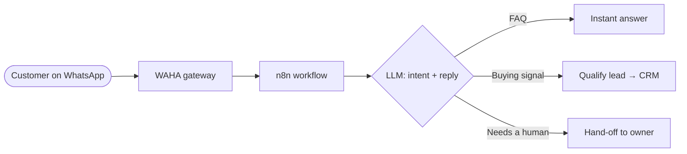

<!-- ═══════════════════════════ HERO ═══════════════════════════ -->
<a href="https://praful-us-ai-product-developer.projectvinyas.chatgpt.site/"></a>

<p align="center">
  <a href="https://praful-us-ai-product-developer.projectvinyas.chatgpt.site/"></a>
  <a href="https://linkedin.com/in/prafulus"></a>
  <a href="https://wa.me/918050392399?text=Hi%20Praful%2C%20I%20found%20your%20GitHub%20profile%20and%20would%20like%20to%20discuss%20an%20AI%20automation%20project."></a>
  <a href="https://www.instagram.com/botify_india_/"></a>
  <a href="mailto:uspraful1@gmail.com"></a>
  
</p>

<p align="center"></p>

<p align="center"></p>

<p align="center"></p>

<!-- ═══════════════════════════ WORK ═══════════════════════════ -->
## ⚡ What I build

<table>
<tr>
<td width="50%"><a href="https://github.com/Praful-lab/voxintell"></a></td>
<td width="50%"><a href="https://github.com/Praful-lab/eduflourish-website"></a></td>
</tr>
<tr>
<td width="50%"><a href="https://praful-us-ai-product-developer.projectvinyas.chatgpt.site/"></a></td>
<td width="50%"><a href="https://www.instagram.com/botify_india_/"></a></td>
</tr>
</table>

**Also built:** 🌿 a CNN crop-disease detector (3,500 images, >90% accuracy) driving an ESP32 sprayer · 🛡️ ML-based Android RAT detection *(M.Tech research)* · 🎯 a production PHP → Meritto CRM fix that stopped admission leads being silently rejected.

<details>
<summary><b>🧬 Read my source code</b></summary>
<br/>

```python
class PrafulUS:
    role      = "AI Product Developer @ EduFlourish"
    venture   = "Founder, BotifyIndia — WhatsApp AI agents for small businesses"
    base      = "Mangalore, Karnataka, India 🇮🇳"
    education = ["B.E. Artificial Intelligence & ML — VCET (2021–25)",
                 "M.Tech — research on ML-based Android RAT detection"]

    builds = {
        "llm":        ["LoRA fine-tuning (Qwen3-4B)", "prompt systems", "AI-generated assessments"],
        "agents":     ["AI voice interviews", "WhatsApp chatbots", "call-training simulators"],
        "ml":         ["CNN vision models", "clustering + PCA", "malware detection"],
        "product":    ["React / FastAPI / PHP / Spring Boot", "CRM integrations", "live dashboards"],
    }

    def philosophy(self) -> str:
        return "If a human does it twice, an agent should do it the third time."
```

</details>

<details>
<summary><b>🔌 How a BotifyIndia agent thinks</b></summary>
<br/>



</details>

<p align="center"></p>

<!-- ═══════════════════════════ STACK ═══════════════════════════ -->
## ⚙️ Tech arsenal

**AI / ML**
<p>
  
  
  
  
  
  
  
  
  
</p>

**Product engineering**
<p>
  
</p>

**Automation & integrations**
<p>
  
  
  
  
  
</p>

<p align="center"></p>

<!-- ═══════════════════════════ PATH ═══════════════════════════ -->
## 🧭 Training run

```text
epoch 05 │ AI Product Developer ······ EduFlourish ············ now        ▶ shipping LLM products
epoch 04 │ Founder ··················· BotifyIndia ············ now        ▶ WhatsApp AI agents
epoch 03 │ AI Prompt Engineer ········ Xtransmatrix ··········· 2025–26    ★ Best Performer
epoch 02 │ Testing Intern ············ IFB ···················· 2025
epoch 01 │ AI/ML Industry Intern ····· Rooman Technologies ···· 2024–25    ▶ PCA + K-Means journeys
─────────┴────────────────────────────────────────────────────────────────────────────────────────
loss ↓   │ NSQF L5 AI–ML Engineer (480 h) · Generative AI Mastermind (Outskill) · NxtWave DBs · Udemy Python
```

<p align="center"></p>

<!-- ═══════════════════════════ ACTIVITY ═══════════════════════════ -->
## 📈 Commit telemetry

<p align="center">
  
</p>

<p align="center">
  
</p>

<p align="center">
  <picture>
    <source media="(prefers-color-scheme: dark)" srcset="https://raw.githubusercontent.com/Praful-lab/Praful-lab/output/github-snake-dark.svg"/>
    
  </picture>
</p>

<p align="center"></p>

<!-- ═══════════════════════════ CTA ═══════════════════════════ -->
## 🤝 Let's build something intelligent

Working on an **AI product, a WhatsApp agent, an internal workflow, or a CRM-connected customer journey?**
I build the model, the backend and the interface — and wire them into the tools your team already uses.

<p align="center">
  <a href="https://wa.me/918050392399?text=Hi%20Praful%2C%20I%20found%20your%20GitHub%20profile%20and%20would%20like%20to%20discuss%20an%20AI%20automation%20project."></a>
  <a href="https://linkedin.com/in/prafulus"></a>
</p>

<p align="center"></p>
